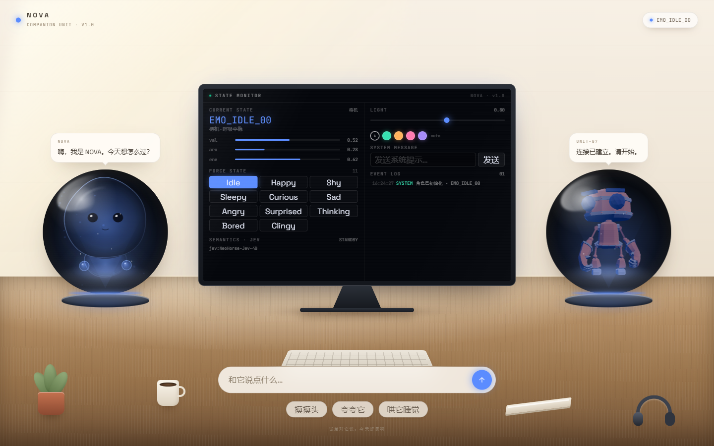
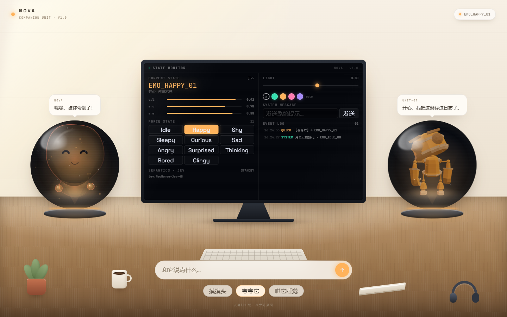
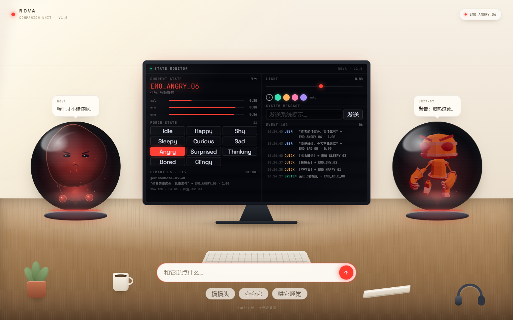
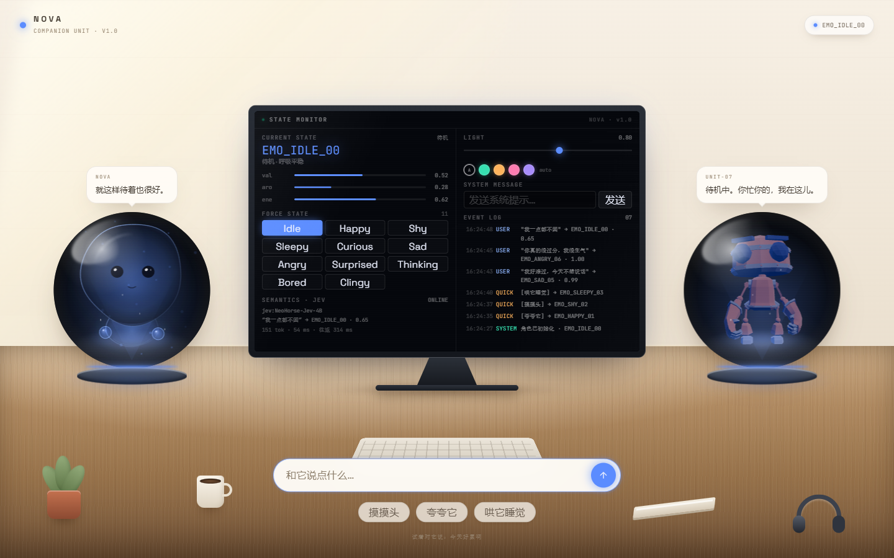

# NOVA · 伴侣小生命情绪互动原型

一个单页 Web 互动原型：白天的工作桌上放着两颗玻璃投影球，左边是软体小生命，右边是机甲伴侣；中间的显示器里是一个真正的开发者调试台（不是覆盖层，是渲染在屏幕里的 DOM）。

两个角色共享同一套情绪状态，但各有各的声音：软体角色说话软、口语化，机器人说话短、像系统日志。情绪会同时驱动它们的动作、表情、颜色，以及球座 LED 环和桌面光斑。



---

## 快速开始

```bash
npm install
npm run dev      # http://localhost:5173
```

```bash
npm run build    # 生产构建
npm run preview  # 预览构建产物
```

环境要求：Node.js `20.19+` 或 `22.12+`（Vite 8）。

机器人模型随仓库提供：`public/models/RobotExpressive.glb`，无需联网。

### 可选：接入 JEV 决策模型

复制 `.env.example` 为 `.env.local`，填入：

```
LLM_API_KEY=你的 key
LLM_BASE_URL=https://tokenrhythm.studio/v1
LLM_MODEL=NeoHorse-Jev-4B
```

不配置也能运行：JEV 不可用时会自动回退到本地规则兜底，并在事件日志里标明 `fallback`。

---

## 场景与交互

```
┌──────────────────────────────────────────────────────────────┐
│  NOVA                                        ● EMO_HAPPY_01   │
│                                                              │
│   ┌ NOVA ┐                        ┌ UNIT-07 ┐                 │
│   │ 气泡 │                        │  气泡   │                 │
│  ╭─┴──────┴─╮    ┌──────────┐   ╭─┴───────┴─╮               │
│  │ 软体小生命 │    │ 显示器    │   │ 机甲伴侣  │               │
│  │（玻璃球）  │    │ = 调试台  │   │（玻璃球） │               │
│  ╰────┬─────╯    └────┬─────┘   ╰────┬──────╯               │
│      LED 环         支架           LED 环                    │
│  ═════════════════ 木 桌 面 ════════════════════════════       │
│        🌿   ☕      ⌨️ 键盘         📓      🎧                │
│                                                              │
│              ┌──────────────────────────────┐                │
│              │  和它说点什么…          [ ↑ ] │                │
│              └──────────────────────────────┘                │
│        [ 摸摸头 ]  [ 夸夸它 ]  [ 哄它睡觉 ]                   │
└──────────────────────────────────────────────────────────────┘
```

| 操作 | 效果 |
| --- | --- |
| 输入文字（停顿 380ms） | 角色实时预览情绪，不用回车 |
| 输入文字 + 回车 | 情绪切换 + 两个角色各说一句 |
| `摸摸头` / `夸夸它` / `哄它睡觉` | 害羞 / 开心 / 困倦 |
| 鼠标移动 | 软体角色视线跟随，机器人转向 |
| 调试台强制切换 | 11 种情绪任选，不参与自然衰减 |

调试台提供：当前状态码、`valence/arousal/energy` 三维数值、强制状态、JEV 判定详情（引擎、置信度、tokens、耗时）、光强滑杆、5 个场景灯光主题色、系统消息、事件日志。

---

## 情绪状态

共 11 种。每种情绪 = 一组连续参数 + 主题色 + 表情 + 两套台词，集中在 `src/data/emotions.ts` 与 `src/data/robotReplies.ts`。

| 状态码 | 名称 | 主色 | 软体表情 | 机甲动作 |
| --- | --- | --- | --- | --- |
| `EMO_IDLE_00` | 待机 | 靛蓝 | 睁眼浅笑 | Idle |
| `EMO_HAPPY_01` | 开心 | 暖金 | 弯眼笑 | Dance |
| `EMO_SHY_02` | 害羞 | 樱粉 | `>_<` | ThumbsUp |
| `EMO_SLEEPY_03` | 困倦 | 暗靛 | 闭眼 | Sitting |
| `EMO_CURIOUS_04` | 好奇 | 生物青 | 睁大眼 | Wave |
| `EMO_SAD_05` | 委屈 | 灰蓝 | 垂眼 + 泪滴 | Sad_pose + Sad 表情 |
| `EMO_ANGRY_06` | 生气 | 正红 | 斜眉窄眼 | Punch + Angry 表情 |
| `EMO_SURPRISED_07` | 惊讶 | 亮紫 | 大圆眼 + o 嘴 | Jump + Surprised 表情 |
| `EMO_THINKING_08` | 思考 | 淡青蓝 | 眼珠上移 | Standing |
| `EMO_BORED_09` | 无聊 | 灰褐 | 半垂眼 | Idle（慢速） |
| `EMO_CLINGY_10` | 撒娇 | 玫瑰粉 | 双高光大眼 | Wave |

开心 / 害羞 / 好奇 / 委屈 / 生气 / 惊讶 / 思考 / 撒娇 带自然衰减，会自己回到待机；调试台强制切换则不衰减。




---

## 语义判定：JEV 决策模型

### 唯一判定来源

每一次输入（包括打字时的实时预览）都直接交给 JEV，**本地规则不参与判定**，只在 JEV 请求失败时自动兜底。

```
用户输入（打字停顿 380ms / 回车）
        ↓
POST /api/classify（本地代理）
        ↓
tokenrhythm.studio/v1/decision
        ↓
choice + probabilities（模型约 55ms，端到端约 400~600ms）
        ↓
角色切换情绪 / 气泡
```

### JEV 是决策模型，不是聊天模型

是 `/v1/decision` 的结构化 `choice` 题型：

```json
{
  "model": "NeoHorse-Jev-4B",
  "state": "我好难过，今天不想说话",
  "questions": {
    "emotion": {
      "type": "choice",
      "instructions": "判断说话者当前最可能的情绪",
      "criteria": {
        "idle": "平静、中性、没有明显情绪",
        "happy": "开心、高兴、愉悦、被夸奖",
        "...": "共 11 项"
      }
    }
  }
}
```

返回直接是 `answers.emotion.choice` 和 11 个选项的概率分布，无需解析自然语言。调试台会显示 `input_tokens`、模型判定耗时和端到端往返。



### 失败回退

客户端 6s / 代理 12s 超时；503（无 Key）、502（上游错误）、非法输出都会返回 `null`，此时自动使用本地规则兜底，并在日志记录「JEV 不可用 · 已回退本地规则」。

### 生产部署注意

`/api/classify` 目前写在 `vite.config.ts` 里的开发服务器中间件。`npm run build` 是纯静态产物，部署到静态托管后该接口不存在，会自动回退本地规则。**要上线需要把这个 handler 搬到真正的服务端**（Vercel/Netlify Function 或独立 Node 服务），API Key 始终只留在服务端。

---

## 技术栈

- **Vite 8 + React 19 + TypeScript**
- **Tailwind CSS 4**（UI 布局）+ 手写 CSS（工作台、玻璃球、灯光）
- **Canvas 2D**：软体小生命的全部绘制（玻璃膜、表情、光球小手、浮尘）
- **Three.js 0.187 + @react-three/fiber 9 + drei 10**：机甲伴侣
- **Zustand 5**：情绪、日志、语义模式

---

## 目录结构

```
src/
├── App.tsx                 # 页面装配、CSS 变量、开场问候
├── MoodDriver.tsx          # 情绪参数逐帧插值（常驻，不随场景卸载）
├── mood.ts                 # 全局可变情绪状态（60fps，不进 React state）
├── data/
│   ├── emotions.ts         # 11 种情绪的参数 / 主题色 / 台词
│   └── robotReplies.ts     # 机甲伴侣的独立台词池
├── store/companion.ts      # zustand：情绪、日志、气泡、光强、语义模式
├── semantics/
│   ├── types.ts            # EmotionRouter 接口
│   ├── localRouter.ts      # 本地规则引擎
│   ├── llm.ts              # JEV 客户端
│   └── index.ts
├── scene/
│   ├── CanvasCreature.tsx  # 软体小生命（Canvas 2D 全量绘制）
│   ├── RobotCreature.tsx   # 机甲伴侣：动画 crossFade + 表情 morph + 染色
│   └── RobotStage.tsx      # 球内的小 WebGL 舞台
└── ui/
    ├── DeskScene.tsx       # 工作台、玻璃球、道具、显示器
    ├── MonitorConsole.tsx  # 显示器里的调试台
    ├── SpeechBubble.tsx    # 单角色气泡（左右各一个）
    ├── TopBar.tsx
    └── Dock.tsx            # 输入框 + 快捷互动
```


